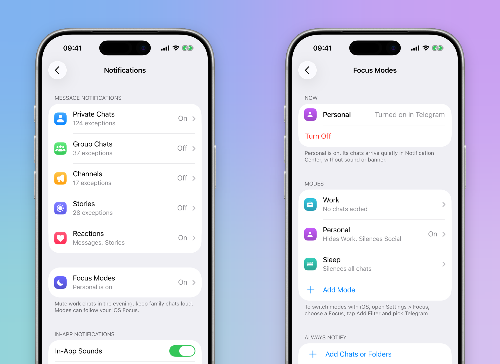
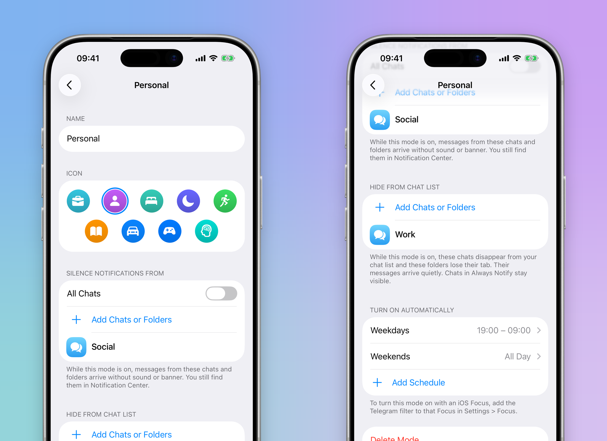
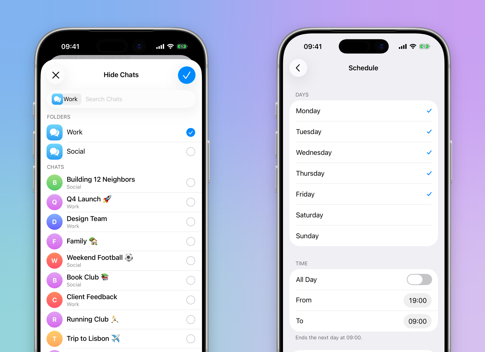
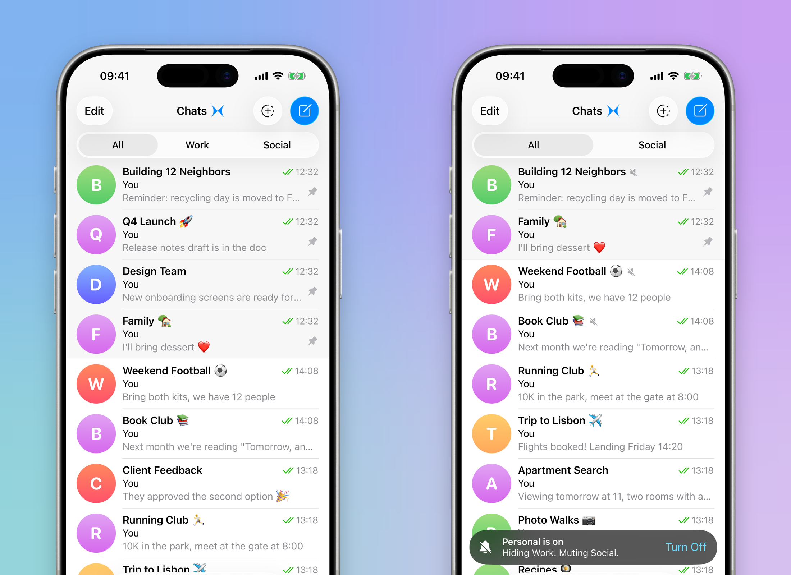

# Focus Modes: Telegram that follows your iOS Focus

Telegram is where many people work and where they talk to their family. iOS Focus can only allow or silence Telegram as a
whole, so in the evening the work group keeps buzzing, or the family goes quiet along with it. Focus Modes let Telegram
follow your Focus chat by chat: work folders disappear after hours, other chats go quiet, and the family always gets
through.

[Demo video](demo.mp4): the Personal mode is set up to hide the Work folder and silence the Social folder, it is turned
on, and back in the chat list the Work tab and its chats leave while a toast says what happened. **Turn Off** in the
toast brings them back. Recorded in the iOS Simulator with [showtime](https://github.com/mishanaer/showtime) on a build of this patch;
a local recording filter, not part of the patch, kept everything except the demo chats off screen.



## Why

Today there are two tools, and neither fits:

- **Mute** is permanent. Muting the work group at 7 pm means remembering to unmute it at 9 am, every day.
- **iOS Focus** sees Telegram as one app. Allow it and every chat breaks through; silence it and so does your mother.

People who use Telegram for work end up muting and unmuting by hand, or they turn notifications off and miss what
matters. Focus Modes add the missing piece: rules per chat and per folder that switch on by themselves.

## What it does

### 1. Focus Modes in Notifications and Sounds

Settings > Notifications and Sounds has a new **Focus Modes** row. It says "Off", or "On" with the mode that is on.

The Focus Modes screen has:

- **Now:** the active mode and what turned it on: "On with iOS Focus", "On by schedule", "Turned on in Telegram" or
  "On until 19:00". **Turn On a Mode** turns one on by hand **For 1 Hour**, **Until This Evening** or **Until I Turn It
  Off**, the way iOS does it for its own Focuses.
- **Modes:** Work, Personal and Sleep to start with, each with a line saying what it hides, what it silences and when it
  runs. **Add Mode** creates more.
- **Always Notify:** chats and folders that notify you in every mode.
- **Show as Muted in Chat List.**

### 2. A mode

A mode has a name, an icon from the same set as iOS Focus, and three lists:

- **Silence Notifications From:** chats and whole folders. They stay in the chat list with the muted icon, and their
  messages arrive in Notification Center without sound or banner. **All Chats** silences everything except Always
  Notify, for Sleep.
- **Hide from Chat List:** chats and folders that disappear while the mode is on. A hidden folder loses its tab. Hidden
  chats are silenced too.
- **Turn On Automatically:** schedules such as "Weekdays, 19:00 – 09:00" and "Weekends, All Day". A range that ends
  before it starts runs past midnight.

Chats and folders are picked in the folder editor's picker, with your folders listed above the chats.





### 3. In the chat list

The change happens in front of you. A mode can turn on while you are elsewhere, in Settings, by a schedule or with an
iOS Focus, so the chat list keeps showing the old state until you come back to it. Then the hidden folder's tab and its
chats animate out, silenced chats get the muted icon, and a toast above the tab bar says what happened: **"Personal is on.
Hiding Work. Muting Social."** with **Turn Off** when the mode was turned on by hand. **Turn Off** brings everything back at once. When a mode turns
off any other way, everything comes back with **"Personal is off"**.

Nothing is muted on the server and no chat settings change, so there is nothing to undo in the morning.



### 4. Always Notify

Chats and folders in Always Notify are delivered as **Time Sensitive** notifications. iOS lets Time Sensitive
notifications through a Focus that silences Telegram, so the family group reaches you during Sleep or Do Not Disturb
while everything else in Telegram stays quiet. They also stay visible inside a hidden folder.

### 5. Straight from iOS Focus

Focus Modes connect to the iOS Focus settings you already use. Telegram adds a native **Focus Filter**: in iOS
**Settings > Focus**, choose a Focus such as Work or Personal, tap **Add Filter** under Focus Filters, pick **Telegram**
and choose the Telegram mode for that Focus.

From then on, turning the Focus on from Control Center, from its iOS schedule, by location or with an app also turns on
the Telegram mode, and turning it off turns the mode off. The Focus Modes screen then says "On with iOS Focus". People do
not have to learn a second set of schedules: the ones they made in iOS drive Telegram.

A mode turned on by hand wins over the iOS Focus, and the iOS Focus wins over a Telegram schedule.

## How it works

- **The rules** (`submodules/FocusModes`) are plain Swift with no dependencies: modes, schedules, chats and folders, and
  one function that answers "regular, silenced or always notify" for a chat at a given moment, and another for "hidden".
  They are stored as JSON in the app group, next to the other files the notification extension reads.
- **The Notification Service extension** already decrypts every push. It now asks the rules about the chat and sets the
  notification's `interruptionLevel`: `.passive` with no sound for a silenced or hidden chat, `.timeSensitive` for Always
  Notify. This needs nothing from the server and works while the app is closed, because a schedule is evaluated when the
  push arrives.
- **The Focus Filter** (`TelegramFocusFilter`, a `SetFocusFilterIntent` from App Intents) is linked into the app and
  registered through the app's `app_intents`, so the build extracts its metadata into `Metadata.appintents`. iOS runs it
  when the Focus turns on and again when it turns off. It writes the chosen mode to a second small file, so a Focus change
  never overwrites an edit made in Settings.
- **Folders** are resolved by the app: the extension cannot evaluate a folder's chat types, so the app stores the chats
  each folder holds and refreshes them while it runs (`FocusModesFolderSynchronizer`).
- **In the app**, the incoming message pipeline drops silenced chats before the banner and sound. The chat list leaves
  out hidden chats, ORs "silenced by the active mode" into a row's muted state, and drops hidden folders from the tabs.
  It follows a presented copy of the state (`FocusModesChatListPresentation`) that the root chat list moves forward only
  while it is on screen, which is what makes the change animate in view and lets it say so in a toast.

## Limitations

1. **The Focus Filter needs a device.** The iOS Simulator has no Focus settings, so the demo turns the mode on from
   Telegram. The filter builds and its App Intents metadata is in the app; test the iOS side on an iPhone.
2. **Time Sensitive needs a capability.** `com.apple.developer.usernotifications.time-sensitive` has to be enabled for
   the App ID. The entitlement is added only for the official bundle ids.
3. **Folders are a snapshot.** A chat that joins a folder by its type (a new group in "All groups") is picked up the
   next time the app runs.
4. **The rules are per device.** They are not synced to other devices or to Telegram Desktop.
5. **Muted stays muted.** A chat muted in Telegram sends no push, so Always Notify cannot wake it up. It only lifts chats
   above a Focus.

## Applying the change

`changes.patch` is the difference from the official Telegram-iOS master at commit `24638bc6`. From a checkout of that
commit:

```
git apply --check changes.patch
git apply changes.patch
```

Then build as described in the Telegram-iOS README. The new code is in `submodules/FocusModes/` (rules, storage, signals
and the Focus Filter) and `submodules/SettingsUI/Sources/Notifications/FocusModes/` (the screens), with hooks in the
Notification Service extension, `ChatListUI` and `ApplicationContext`.

The rules have host tests:

```
./build-input/bazel-9.2.0-darwin-arm64 test //submodules/FocusModes:FocusModesTests
```
